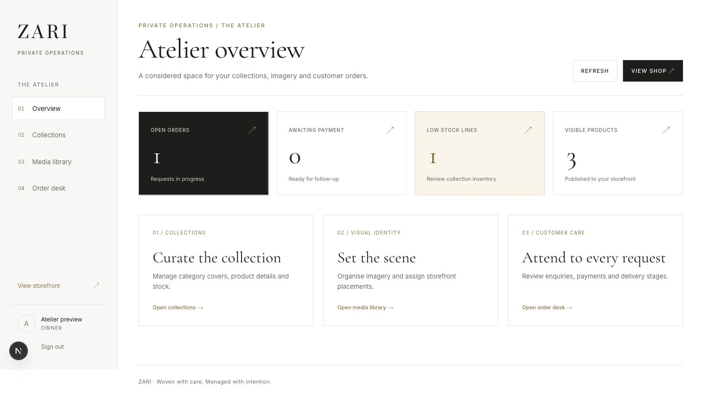
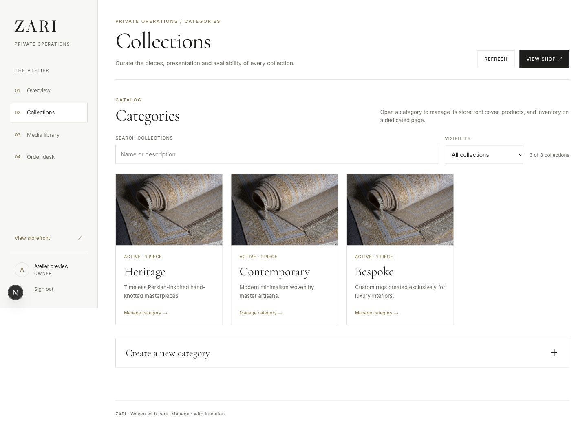
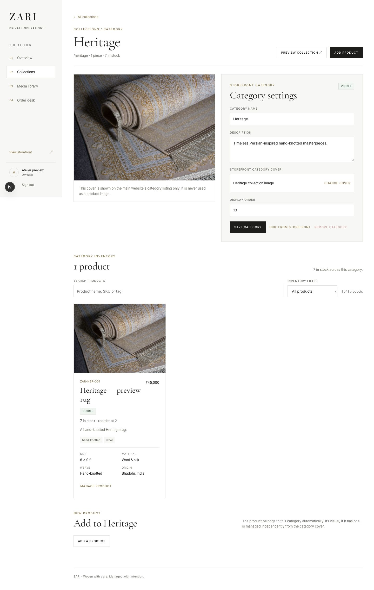
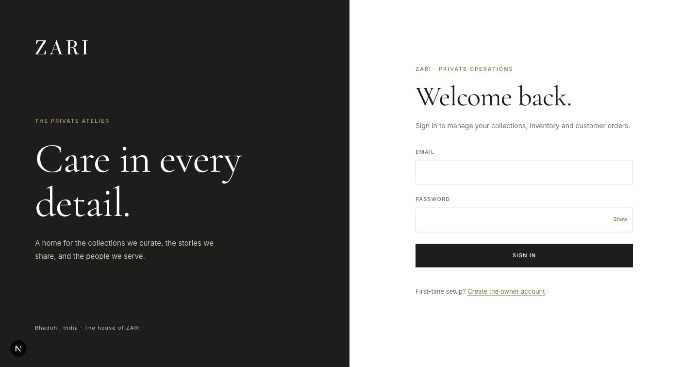

# ZARI operations portal quality review

Reviewed on 18 November 2026 against the live admin dashboard and `https://zarirugs.com`. The portal is served from the repository's **admin** branch; this change targets that branch.

## Findings and fixes

| Area | Observed issue | Change |
| --- | --- | --- |
| Brand | Arial/Georgia, beige page backgrounds and divergent golds made the portal feel separate from the storefront. | Reuse the repository's storefront colour tokens and the same Inter, Cormorant Garamond and Prata families. Bundle licensed fonts locally for repeatable builds. |
| Navigation | Catalog, media, uploads and orders occupied one long page with no persistent navigation. | Shared desktop sidebar and wrapping mobile navigation; bookmarkable overview, collection, media and order views. Load only the selected workspace's data. |
| Hierarchy | Oversized titles, tiny labels, adjoining panels and inconsistent spacing obscured operational tasks. | Shared page headers, form fields, buttons, feedback, badges and empty states. White surfaces, consistent borders and restrained gold accents. |
| Discovery | Categories, products, assets and orders could only be found by scrolling. | Search and visibility, inventory, media-type and order-stage filters with result counts. |
| Editing | Creation forms dominated the page. Product name and sort order had no editor. Closing an editor retained stale drafts. | Reveal category/product creation on demand, expose product name/order, discard drafts on Cancel and refresh all saved fields. |
| Media | Videos were compressed as images and stored as WebP. Broken previews appeared as blank coloured rectangles. Every video autoplayed. | Stream MP4 bytes with the correct extension/MIME type; retain image compression; show image/video failure states and use explicit video controls. Upload limits are visible. |
| Feedback | Network failures could leave authentication busy indefinitely. Session expiry, save failures and success messages looked alike. A failed refresh could report false success. | Shared request handling and distinct announced success/error feedback; reliable loading reset; session-expiry sign-in link; distinguish saved changes from refresh failures. Media editing moves focus into the editor. |
| Orders | Changing a select immediately changed an order and stock. UTC timestamps were parsed ambiguously. | Require an explicit Update stage action; show the saved stage, closed-order state and IST timestamps. |
| Inventory | Paid → unpaid transitions retained reserved stock. Stale concurrent changes could double-reserve stock or mark an order paid after stock was exhausted. | Balance every transition across the reservation boundary; guard all stock statements and the stage change in one D1 transaction; rollback on insufficient stock and return a conflict for stale stages. |
| Order completeness | Independent 100-order/500-line limits could omit order items; ties had no stable ordering. | Select every line belonging to the latest 100 orders, with a stable timestamp/id order. |
| Metrics | Visible-products count included inactive inventory and hidden categories. | Apply the same category/inventory visibility conditions as the storefront. |
| Accessibility | Small action targets, missing keyboard focus indicators and unnamed repeated actions hindered use. | At least 44px primary action targets, focus rings, skip link, labelled controls, expanded/selected states, descriptive media actions and reduced-motion support. |
| Regression protection | Admin CI did not execute the existing tests. | Run all 16 API, request and gallery tests in the admin PR workflow. |

## Validation

- `npm run lint` in `admin-portal`: passed.
- `npm run typecheck` in `admin-portal`: passed.
- `npm test` in `admin-portal`: 16 passed. Includes video-byte/MIME preservation, image compression, auth failures, reservation/release cycles, stale-stage conflicts, stock-depletion rollback, complete order lines, visible-product counts and existing gallery validation.
- `npm run build:cloudflare` in `admin-portal`: passed; OpenNext Worker bundle generated.
- Browser checks used a separate local D1 database and fictional preview accounts/orders. Production records were inspected without edits.
- Verified sign-in, incorrect-password feedback, sign-out, workspace navigation, collection/media search empty states, product Cancel/reset and save/reload, media editor focus, and explicit order-stage save. A paid sample order reduced the sample product's stock from 8 to 7.
- Verified 390px layouts for overview, collection editing, media, orders and sign-in; document width matched viewport width. Desktop review used the normal 1440px browser viewport. Temporary viewport overrides were reset.

## Screenshots

These are local development previews with sample data; they do not represent production records. Preview product/collection images use the repository's existing rug assets.

[Mobile overview](screenshots/overview-mobile.jpg) · [Mobile order desk after save](screenshots/orders-mobile.jpg) · [Mobile sign-in](screenshots/login-mobile.jpg)

## Release and content boundaries

No schema migration, credential change or production data cleanup is included. Merge into **admin** to use the existing admin deployment workflow. The main storefront is the visual reference and is deployed separately from **main**.

Missing product photography, unfinished descriptions and the live empty test category are catalogue content decisions. The UI identifies missing media and supports editing it; this change does not invent product photos or delete business data. Existing broken legacy media references may still require replacement with a valid library asset. The review is scoped to the portal's interface and the functional defects listed above, not a comprehensive security or load audit.

## Font sources

The Latin WOFF2 subsets are bundled under `app/fonts/` with each family's SIL Open Font License. Sources: [Google Fonts CSS API](https://developers.google.com/fonts/docs/css2), [Inter](https://github.com/google/fonts/tree/main/ofl/inter), [Cormorant Garamond](https://github.com/google/fonts/tree/main/ofl/cormorantgaramond), [Prata](https://github.com/google/fonts/tree/main/ofl/prata). The font families match the production storefront.
