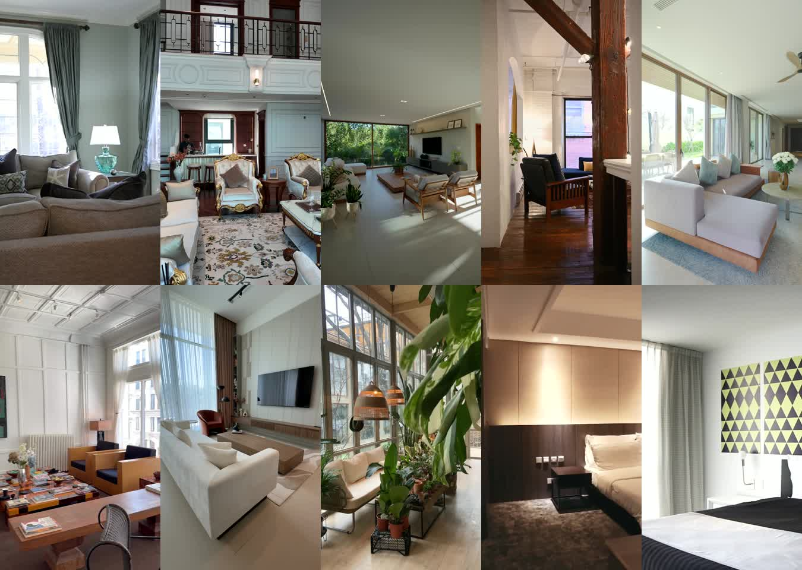

# ZARI room-reveal Reel series — 4–13 November 2026

Merge this PR to approve ten short Reels, one per day at 19:30 India time. The GitHub Actions publisher checks the queue daily and publishes only the next approved, due item. The masters are silent; no commercial music is embedded.

All clips are real stock footage selected for elegant room reveals. The rooms and carpets shown are not ZARI products or customer homes. The ZARI end card is included in each video. Captions are in `marketing/queue.json`; edit them there before merging if needed.

## Contact sheet

## Posting schedule

| Date | Time | Reel | File | Source | Caption |
|---|---:|---|---|---|---|
| Nov 4 | 19:30 IST | The Threshold | [MP4](../../public/marketing/instagram/2026-11-room-series/01-threshold.mp4) | [Pexels](https://www.pexels.com/video/a-panning-shot-of-a-living-room-6356433/) | A room can feel different in a single moment. Which detail caught your eye? |
| Nov 5 | 19:30 IST | The Salon | [MP4](../../public/marketing/instagram/2026-11-room-series/02-salon.mp4) | [Pexels](https://www.pexels.com/video/luxurious-classical-living-room-interior-design-40187579/) | A little old-world calm for your feed. Save this room for later. |
| Nov 6 | 19:30 IST | Sunlit Plan | [MP4](../../public/marketing/instagram/2026-11-room-series/03-sunlit-plan.mp4) | [Pexels](https://www.pexels.com/video/elegant-modern-living-room-with-natural-light-37479012/) | Let the light do the styling. Which corner would you keep? |
| Nov 7 | 19:30 IST | The Doorway | [MP4](../../public/marketing/instagram/2026-11-room-series/04-the-doorway.mp4) | [Pexels](https://www.pexels.com/video/video-of-a-living-room-5824192/) | Would you walk into this room and stay a while? |
| Nov 8 | 19:30 IST | Open Plan | [MP4](../../public/marketing/instagram/2026-11-room-series/05-open-plan.mp4) | [Pexels](https://www.pexels.com/video/modern-minimalist-interior-with-natural-light-40074718/) | Open space, warm wood, and a slower kind of evening. Save this mood. |
| Nov 9 | 19:30 IST | Quiet Light | [MP4](../../public/marketing/instagram/2026-11-room-series/06-quiet-light.mp4) | [Pexels](https://www.pexels.com/video/modern-interior-with-art-and-natural-light-29586731/) | When the light becomes part of the design. Morning or evening? |
| Nov 10 | 19:30 IST | Morning Room | [MP4](../../public/marketing/instagram/2026-11-room-series/07-morning-room.mp4) | [Pexels](https://www.pexels.com/video/modern-minimalist-living-room-design-36516349/) | A slow morning, in a room made for it. What would you add? |
| Nov 11 | 19:30 IST | The Green Room | [MP4](../../public/marketing/instagram/2026-11-room-series/08-green-room.mp4) | [Pexels](https://www.pexels.com/video/living-room-full-of-house-plants-7235796/) | A little green makes a room feel alive. Which plant-filled corner is your favourite? |
| Nov 12 | 19:30 IST | Hotel Warmth | [MP4](../../public/marketing/instagram/2026-11-room-series/09-hotel-warmth.mp4) | [Coverr](https://coverr.co/videos/hotel-room-tour-thlihgx1i6) | Check in, switch off. Save this feeling for your next reset. |
| Nov 13 | 19:30 IST | Graphic Calm | [MP4](../../public/marketing/instagram/2026-11-room-series/10-graphic-calm.mp4) | [Mixkit](https://mixkit.co/free-stock-video/hotel-room-with-modern-minimalist-style-4488/) | Less noise, more room to breathe. Which room should we reveal next? |

## Approval notes

- The schedule runs 4–13 November 2026 at 19:30 IST (14:00 UTC), including Sunday 8 November. The publisher workflow now checks daily; queue entries remain the only trigger for posting.
- The queue entries are marked `approved` because merging this PR is the human approval action. They will not publish before merge and the scheduled time.
- Each post is one Reel. Audio is silent unless the account owner adds music separately; no track was provided for this batch.
- These are mood/editorial interiors, not product demonstrations. The creative objective is short, moving room reveals and a restrained ZARI end card.
- Before merge, review the preview sheet and confirm the dates/captions. After merge, GitHub Actions will publish one due Reel per day.

Source download terms checked against the platform pages on 1 November 2026. See source pages for current terms: [Pexels license](https://www.pexels.com/license/), [Coverr license](https://coverr.co/license), [Mixkit license](https://mixkit.co/license/).
